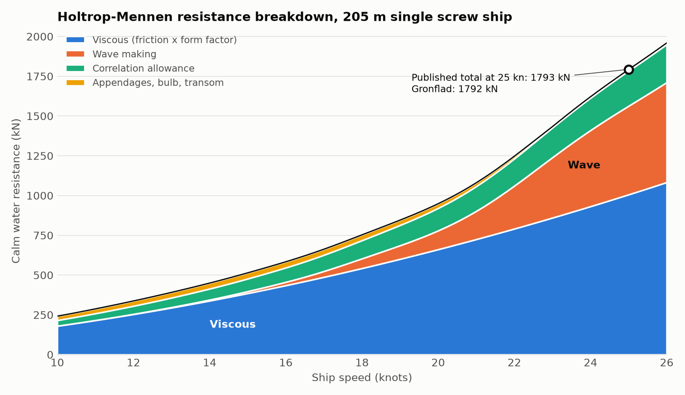

# Gronflad

**How much energy does a ship need on a given route, and how much can wind assistance and alternative fuels save?**

Gronflad (from the Danish *grønne flåde*, "green fleet") is an open source voyage energy model for low carbon shipping. It chains naval architecture and energy engineering in one transparent Python library:

1. **Hull resistance** in calm water (Holtrop and Mennen method)
2. **Propulsion**: hull-propeller interaction, propeller efficiency, shaft power
3. **Route and weather**: real wind along a shipping lane *(planned)*
4. **Wind assistance**: thrust and power saving of Flettner rotors *(planned)*
5. **Alternative fuels**: ammonia, methanol, LNG and hydrogen compared on bunker volume, cargo capacity loss and well-to-wake emissions *(planned)*



## Validation first

Every model is checked against published data before it is used. The resistance and propulsion modules reproduce the numerical example of Holtrop and Mennen (1982), a 205 m single screw ship at 25 knots:

| Quantity | Published | Gronflad | Deviation |
|---|---:|---:|---:|
| Wetted surface S (m²) | 7381.45 | 7381.45 | 0.00 % |
| Form factor 1+k₁ | 1.156 | 1.156 | 0.0 % |
| Frictional resistance R_F (kN) | 869.63 | 869.64 | 0.00 % |
| Wave resistance R_W (kN) | 557.11 | 556.95 | 0.03 % |
| Total resistance R_T (kN) | 1793.26 | 1792.10 | 0.06 % |
| Wake fraction w | 0.2584 | 0.2580 | 0.15 % |
| Thrust deduction t | 0.1747 | 0.1747 | 0.0 % |
| Relative rotative efficiency η_R | 0.9931 | 0.9931 | 0.0 % |
| Shaft power P_S (kW) | 32621 | 32618 | 0.01 % |

The small residual on R_A and R_T comes from rounding of C_A in the paper. All values are enforced by the test suite (`tests/test_holtrop_mennen_1982.py`).

The method is statistical. Gronflad raises a `ValidityWarning` when a hull or speed falls outside the regression envelope (Froude number, prismatic coefficient, L/B, B/T) instead of silently extrapolating.

## Quick start

```bash
git clone https://github.com/enzoprt/gronflad.git
cd gronflad
python -m venv .venv && source .venv/bin/activate
pip install -e ".[dev]"
pytest
```

```python
from gronflad import KNOT, Hull, Propeller, propulsion, resistance

hull = Hull(
    L=205.0, B=32.0, T_F=10.0, T_A=10.0, volume=37500.0, lcb=-0.75,
    C_M=0.98, C_WP=0.75, A_BT=20.0, h_B=4.0, A_T=16.0, S_APP=50.0, C_stern=10.0,
)
res = resistance(hull, 25 * KNOT)
print(f"Total resistance: {res.R_T / 1e3:.0f} kN, effective power: {res.P_E / 1e3:.0f} kW")

prop = propulsion(hull, Propeller(D=8.0, Z=4), res, eta_O=0.646)
print(f"Shaft power: {prop.P_S / 1e3:.0f} kW")
```

## Roadmap

- [x] Holtrop and Mennen (1982) calm water resistance, validated
- [x] Propulsion factors (w, t, η_R) and Keller blade area, validated
- [ ] Wageningen B-series open water model (replaces the η_O input)
- [ ] Validation on the KRISO Container Ship (KCS) towing tank data
- [ ] Fuel module: LHV, density, tank factors, FuelEU Maritime well-to-wake factors
- [ ] Route module: great circle legs and ERA5 wind along the route
- [ ] Flettner rotor model (lift and drag versus spin ratio, rotor power consumption)
- [ ] Interactive web demo

## References

- Holtrop, J. and Mennen, G.G.J. (1982). An approximate power prediction method. *International Shipbuilding Progress*, 29(335), 166-170.

## Author

Enzo Pierrot, energy and mechanical engineering student at Polytech Marseille, working at the crossing of energy engineering and naval architecture.
[LinkedIn](https://www.linkedin.com/in/enzoprt) · [GitHub](https://github.com/enzoprt)

## License

MIT
