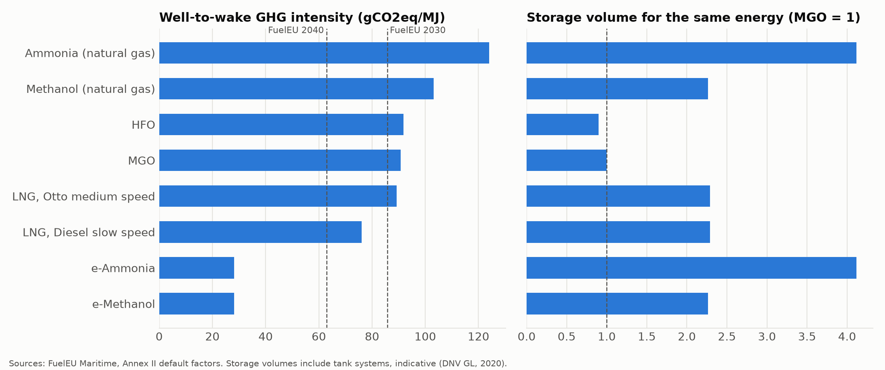
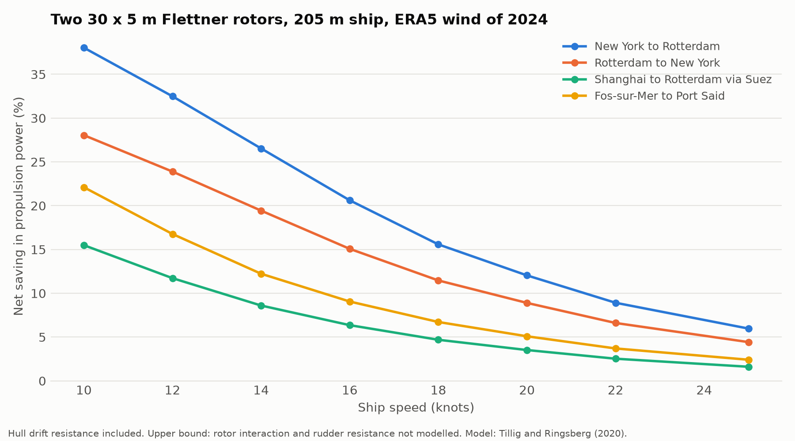
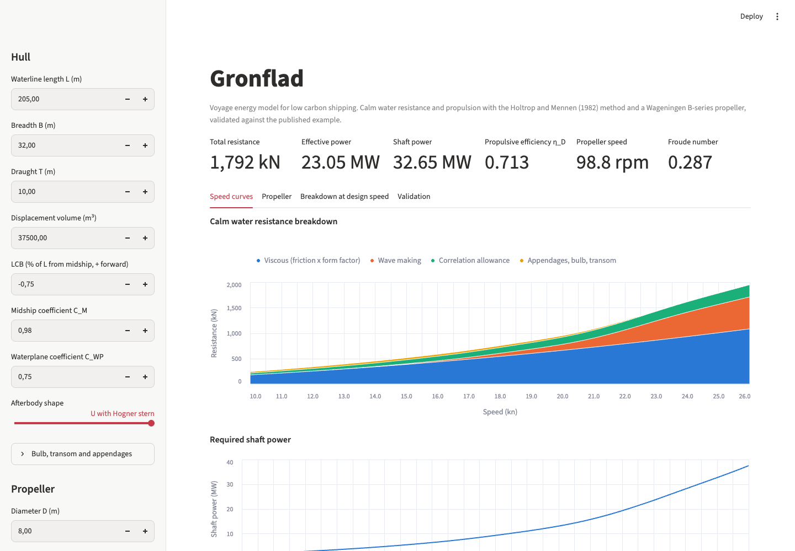
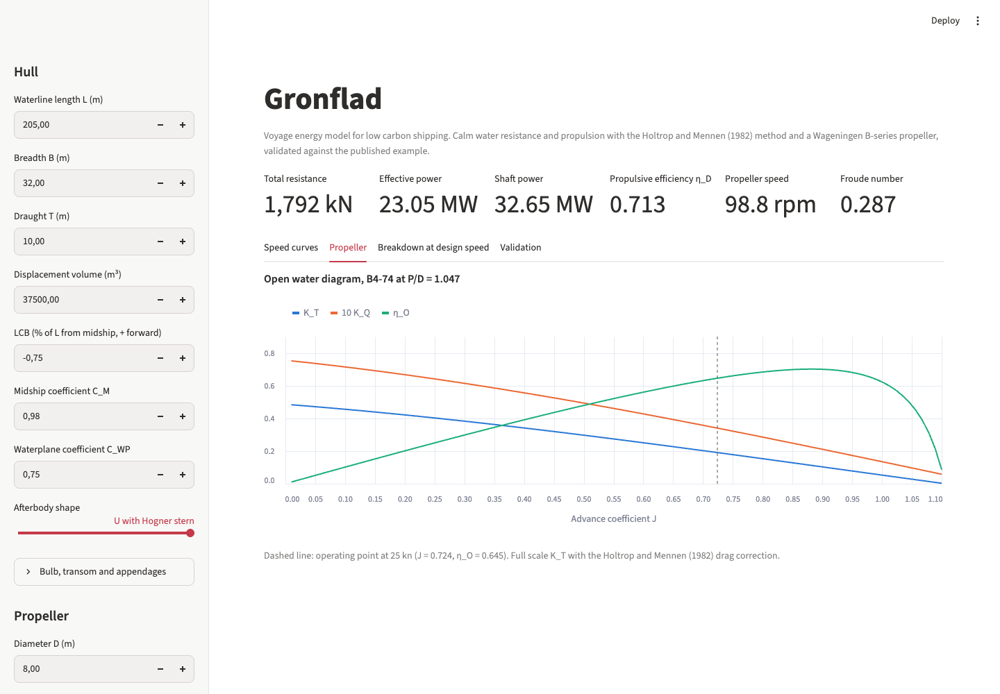
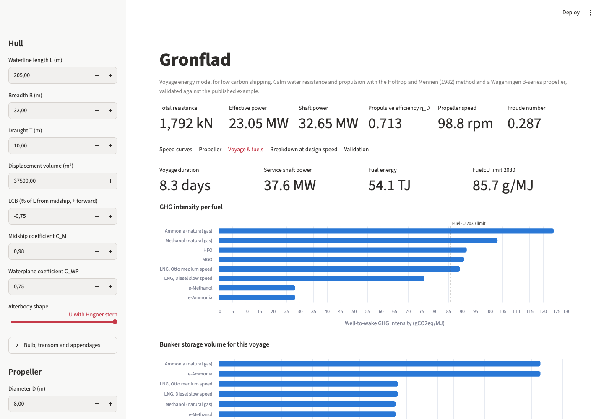
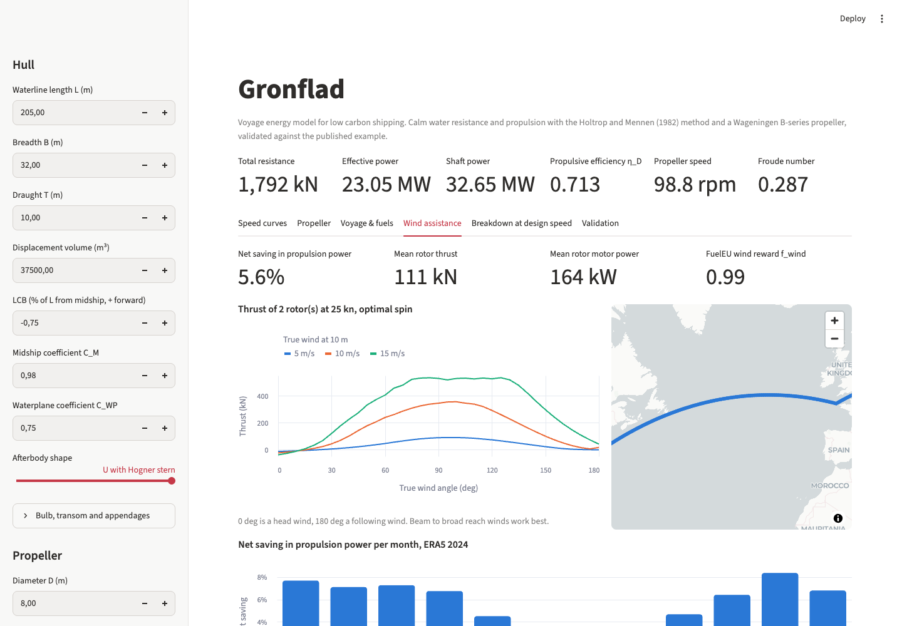

# Gronflad

[](https://gronflad.streamlit.app)

**How much energy does a ship need on a given route, and how much can wind assistance and alternative fuels save?**

Gronflad (from the Danish *grønne flåde*, "green fleet") is an open source voyage energy model for low carbon shipping. It chains naval architecture and energy engineering in one transparent Python library:

1. **Hull resistance** in calm water (Holtrop and Mennen method)
2. **Propulsion**: hull-propeller interaction, Wageningen B-series propeller, shaft power
3. **Voyage and fuels**: ammonia, methanol, LNG and hydrogen compared on bunker mass, storage volume, lost container slots, well-to-wake emissions and FuelEU Maritime compliance
4. **Route and weather**: great circle routes with a full year of ERA5 reanalysis wind
5. **Wind assistance**: Flettner rotor thrust, motor power and net fuel saving along the route


## Validation first

Gronflad is a pure software project. Every model is checked against data already published in the literature before it is used, no new measurements are involved. The resistance and propulsion modules reproduce the numerical example of Holtrop and Mennen (1982), a 205 m single screw ship at 25 knots. Starting from the hull particulars alone, with a B-series propeller at optimum pitch:

| Quantity | Published | Gronflad | Deviation |
|---|---:|---:|---:|
| Wetted surface S (m²) | 7381.45 | 7381.45 | 0.00 % |
| Form factor 1+k₁ | 1.156 | 1.156 | 0.0 % |
| Frictional resistance R_F (kN) | 869.63 | 869.64 | 0.00 % |
| Wave resistance R_W (kN) | 557.11 | 556.95 | 0.03 % |
| Total resistance R_T (kN) | 1793.26 | 1792.10 | 0.06 % |
| Wake fraction w | 0.2584 | 0.2580 | 0.15 % |
| Thrust deduction t | 0.1747 | 0.1747 | 0.0 % |
| Relative rotative efficiency η_R | 0.9931 | 0.9931 | 0.0 % |
| Open water efficiency η_O | 0.6461 | 0.6454 | 0.1 % |
| Propeller speed n (rpm) | 99.6 | 98.8 | 0.7 % |
| Shaft power P_S (kW) | 32621 | 32655 | 0.10 % |

The small residual on R_A and R_T comes from rounding of C_A in the paper. The paper does not print its pitch ratio, so Gronflad picks the optimum one, which explains the small difference in propeller speed. At the published rpm, the B-series polynomials match the published K_T within 0.04 % and K_Q within 0.14 %. All values are enforced by the test suite (`tests/`).

The 86 B-series polynomial coefficients were cross-checked term by term against two independent open source codes before use.

### Comparison with the KRISO Container Ship (KCS)

The KCS is the open benchmark hull of the naval hydrodynamics community. Some Holtrop inputs (waterplane coefficient, bulb area and height, transom area, entrance angle) are not published, so Gronflad computes them from the official IGES hull of the SIMMAN 2008 workshop. It reads the 55 NURBS surfaces, tessellates them and integrates the hydrostatics. The published particulars are recovered first as a check:

| Quantity | Published | Computed from IGES | Deviation |
|---|---:|---:|---:|
| Displacement volume (m³) | 52030 | 52051 | 0.04 % |
| LCB (% L_pp, fwd +) | -1.48 | -1.480 | 0.03 % |
| Midship coefficient C_M | 0.985 | 0.984 | 0.09 % |
| Wetted surface w/o rudder (m²) | 9530 | 9546 | 0.17 % |
| Waterline length (m) | 232.5 | 232.45 | 0.02 % |

With these inputs, Holtrop and Mennen overpredicts the total resistance at the 24 knot design speed by about 10 % compared with the FORCE Technology model test (Lee et al., 2019), extrapolated to full scale with the ITTC 1978 method. Most of the gap is in the wave resistance. This is the honest accuracy of a statistical method applied to a single hull, and the reason Gronflad reports its assumptions.

The method is statistical. Gronflad raises a `ValidityWarning` when a hull or speed falls outside the regression envelope (Froude number, prismatic coefficient, L/B, B/T) instead of silently extrapolating.

## Alternative fuels



Emission factors are the official defaults of FuelEU Maritime (Regulation (EU) 2023/1805, Annex II), combined with the Annex I method including methane slip. Grey ammonia and methanol made from natural gas are worse than heavy fuel oil on a well-to-wake basis. Only e-fuels (RFNBO) meet the long term limits, and they come with two to four times the storage volume. For a given voyage, Gronflad turns this into tonnes of fuel, cubic metres of tanks, container slots lost compared with MGO and the FuelEU penalty for the chosen year.

Storage volumes including tank systems are indicative values derived from DNV GL (2020). Pilot fuel, the RFNBO multiplier and per-engine efficiency differences are not modelled yet.

## Wind assistance



Gronflad sails the ship along a real route with every 6 hour ERA5 wind sample of 2024, on 200 nm legs. At each sample the rotors run at the speed that maximises the net saving, within the manufacturer limits of a 30 x 5 m rotor sail (225 rpm, 270 kN). Lift, drag and motor power come from the coefficients of Tillig and Ringsberg (2020), fitted to full-scale measurements. The rotor side force makes the hull sail at a small drift angle, and the resulting resistance is deducted using the low aspect ratio wing model of the same paper, which cuts the saving by about a fifth. The saving then flows into the fuel comparison and the FuelEU wind reward factor.

Three routes are included, each checked against a global elevation model so that no leg crosses land (only the Suez Canal shows up, as expected for a 300 m wide channel): Rotterdam to New York, Shanghai to Rotterdam via Suez, and Fos-sur-Mer to Port Said.

Two lessons stand out. Wind assistance pays off far more at slow steaming, because rotor thrust stays roughly constant while propulsion power falls with the cube of speed. And the route matters as much as the hardware: with the 2024 wind, the North Atlantic gives two to three times the saving of the Asia to Europe loop, where long stretches through the Malacca Strait and the Red Sea offer little usable wind.

These figures remain an upper bound. Rotor interaction, superstructure effects and rudder resistance are not modelled yet.

## Interactive app

**Live demo: [gronflad.streamlit.app](https://gronflad.streamlit.app)**

Change the hull, the propeller, the speed, the route and the rotors, and see resistance, power, the propeller open water diagram, the rotor saving and the fuel comparison update live. Inputs outside the validity range of the method are flagged on screen.









```bash
pip install -e ".[app]"
streamlit run app/streamlit_app.py
```

## Quick start

```bash
git clone https://github.com/enzoprt/gronflad.git
cd gronflad
python -m venv .venv && source .venv/bin/activate
pip install -e ".[dev]"
pytest
```

```python
from gronflad import KNOT, Hull, Propeller, propulsion, resistance

hull = Hull(
    L=205.0, B=32.0, T_F=10.0, T_A=10.0, volume=37500.0, lcb=-0.75,
    C_M=0.98, C_WP=0.75, A_BT=20.0, h_B=4.0, A_T=16.0, S_APP=50.0, C_stern=10.0,
)
res = resistance(hull, 25 * KNOT)
print(f"Total resistance: {res.R_T / 1e3:.0f} kN, effective power: {res.P_E / 1e3:.0f} kW")

prop = propulsion(hull, Propeller(D=8.0, Z=4), res)  # B-series at optimum pitch
print(f"Shaft power: {prop.P_S / 1e3:.0f} kW at {prop.n * 60:.0f} rpm, P/D = {prop.P_D:.2f}")
```

## Roadmap

- [x] Holtrop and Mennen (1982) calm water resistance, validated
- [x] Propulsion factors (w, t, η_R) and Keller blade area, validated
- [x] Wageningen B-series propeller with full scale correction, validated
- [x] Comparison with the published KCS model test, hull inputs computed from the official IGES geometry
- [x] Fuel module: FuelEU Maritime well-to-wake intensity, storage volume, compliance and penalty
- [x] Route module: great circle legs and ERA5 wind along the route
- [x] Flettner rotor model (lift, drag and motor power versus spin ratio, optimal rpm, operating limits)
- [x] Hull drift resistance from the rotor side force
- [ ] Rudder resistance and yaw balance
- [x] Asia to Europe route via Suez
- [ ] Transpacific route
- [x] Interactive web app (Streamlit)
- [x] Public online deployment: [gronflad.streamlit.app](https://gronflad.streamlit.app)

## References

- Holtrop, J. and Mennen, G.G.J. (1982). An approximate power prediction method. *International Shipbuilding Progress*, 29(335), 166-170.
- Regulation (EU) 2023/1805 of the European Parliament and of the Council on the use of renewable and low-carbon fuels in maritime transport (FuelEU Maritime), Annexes I and II.
- DNV GL (2020). *Ammonia as a marine fuel*. White paper.
- Tillig, F. and Ringsberg, J.W. (2020). Design, operation and analysis of wind-assisted cargo ships. *Ocean Engineering*, 211, 107603.
- SIMMAN 2008 workshop, KCS geometry and conditions, FORCE Technology (simman2008.dk).
- Lee, Y.-G. et al. (2019). Numerical simulations of added resistance in regular head waves on a container ship. *Brodogradnja*, 70(2), 61-86.
- Hersbach, H. et al. (2020). The ERA5 global reanalysis. *Quarterly Journal of the Royal Meteorological Society*, 146, 1999-2049. Data retrieved through the Open-Meteo historical weather API.
- Norsepower (2025). Rotor Sail product brochure (operating limits of the 30 x 5 m rotor).
- Oosterveld, M.W.C. and van Oossanen, P. (1975). Further computer-analyzed data of the Wageningen B-screw series. *International Shipbuilding Progress*, 22(251), 251-262.

## Author

Enzo Pierrot, energy and mechanical engineering student at Polytech Marseille, working at the crossing of energy engineering and naval architecture.
[LinkedIn](https://www.linkedin.com/in/enzoprt) · [GitHub](https://github.com/enzoprt)

## License

MIT
